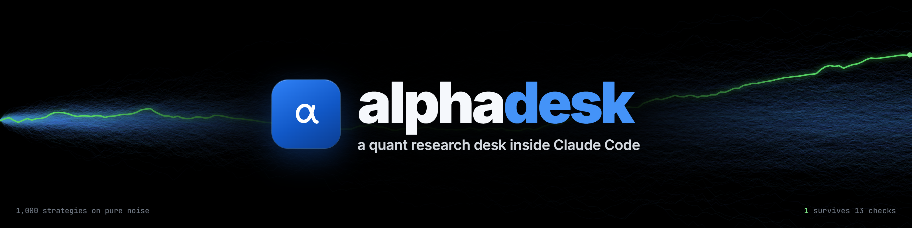
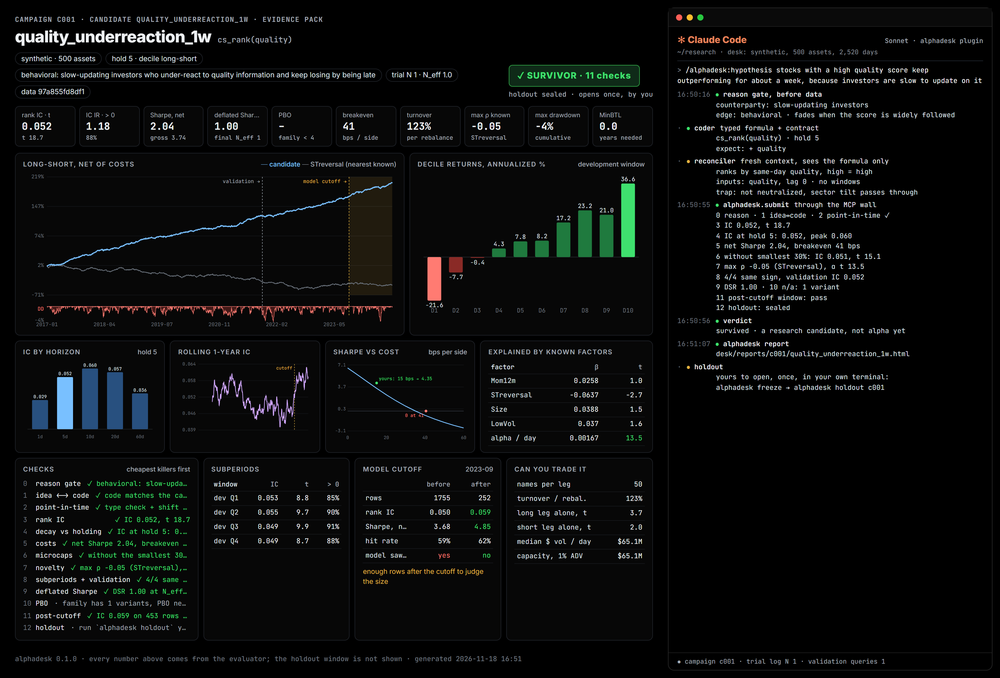
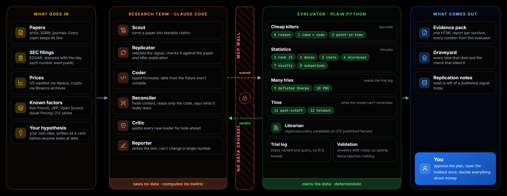

<p align="center">
  
</p>

<p align="center">
  <a href="https://github.com/helicerat/alphadesk/actions/workflows/ci.yml"></a>
  
  
  
  
</p>

**A quant research desk that runs inside Claude Code. Give it a paper, a dataset question or your own hypothesis. It rebuilds the signal, runs it through the 13 checks a fund would run, and hands back an evidence pack for every survivor and a graveyard for everything else.**

The model never computes a metric and never sees the test data. Every number comes from a deterministic evaluator behind an MCP wall: the research agents get one tool, submit a signal and read the verdict, and a plugin hook keeps the session out of the data folder and away from the holdout.

Open source · MIT · Claude Code plugin + Python package · Windows and Linux, no Docker



---

## How it works



1. **The research team works in Claude Code.** The Scout reads a paper and pulls out every testable claim with the line it came from. The Replicator rebuilds the signal and compares it with the paper's own numbers. The Coder writes each variant in a typed formula language where a field from the future doesn't compile. The Reconciler opens the formula in a fresh context, without the idea, and says what it actually does.
2. **Everything crosses the wall as one call.** `submit(card)` returns a verdict: survived, or the number of the check that killed it and why. Data, validation numbers and the holdout stay on the evaluator's side.
3. **The evaluator is plain Python.** It runs the cheapest checks first, logs every attempt so the number of tries is honest, and answers validation queries through Thresholdout, so asking twice teaches the agents nothing.
4. **You hold the last key.** The holdout sits after the model's training cutoff. A plugin hook blocks Claude from running the command that opens it, and the command needs your own terminal. You run it once; every opening is recorded.

---

## Install (2 minutes)

```bash
pip install git+https://github.com/helicerat/alphadesk
alphadesk selftest
```

In Claude Code:

```
/plugin marketplace add helicerat/alphadesk
/plugin install alphadesk@alphadesk
```

Then, in the folder where you want to work:

```bash
alphadesk init --data synthetic     # or binance, or alpaca
```

### See it work, no keys

`alphadesk demo` builds a synthetic market with 3 planted signals of known strength inside 40 noise characteristics and runs a campaign on it:

```
$ alphadesk demo
synthetic market   500 assets · 2,520 days · planted daily IC 0.03 / 0.02 / 0.01
campaign           44 hypotheses

  ✓ quality       IC 0.054  t 20.7  DSR 1.00  found
  ✓ flow          IC 0.033  t 12.9  DSR 1.00  found
  ~ drift         IC 0.017  t  5.9  died at 3 rank IC: below the 0.02 floor
  ✕ trend_follow  IC 0.120  t 12.2  died at 7 novelty: ranks stocks like Mom12m (ρ 1.00)
  ✕ 40 noise      0 survive · 40 at check 3

report  desk/demo/report/index.html
```

The third planted signal is real but weaker than the floor the desk uses, and the desk says so. The fourth is 12-1 momentum written differently; the desk recognizes it.

---

## Using it in Claude Code

| Command | What happens |
|---|---|
| `/alphadesk:replicate paper.pdf` | Scout extracts the claims, Replicator rebuilds the main one, Reconciler checks the code, one honest submission, a report |
| `/alphadesk:hypothesis` | your idea in words → reason → formula → reconciler → one submission |
| `/alphadesk:campaign` | a plan you approve first (question, budget, horizon, stop rules), then rounds of parallel generators, each variant checked and counted |
| `/alphadesk:evidence` | builds and explains the evidence pack |
| `/alphadesk:holdout-brief` | freezes the survivors and gives you the one command that opens the holdout |

And in your terminal:

```bash
alphadesk status                   # tries, validation queries, survivors, graveyard
alphadesk report                   # campaign page + an evidence pack per survivor
alphadesk freeze                   # hash the survivor list into the trial log
alphadesk holdout c001             # you, once
```

---

## The exam

A research system that finds alpha in pure noise is worse than no system. `alphadesk selftest` runs the desk on inputs where the right answer is known. CI runs it on every commit.

| Input | What a broken system does | What the desk does |
|---|---|---|
| 1,000 random strategies, 1 year | reports the best one: Sharpe 3.48 | 0 survive deflation |
| 40 noise characteristics, all checks | finds a few "signals" | 0 survive |
| planted signals, daily IC 0.03 and 0.02 | misses them | both found |
| the same IC 0.02 signal on 60 stocks, 2 years | "finds" it | rejected, t 2.2: too little data to prove it |
| a feature that secretly reads tomorrow's return (IC 1.00) | passes every statistical test | killed at check 2, before any statistics |
| every operator, data cut at t vs full | values before t change | bit-identical |
| a rolling mean with a centered window | ships it | caught |
| a flipped sign, a wrong field, a negative lag | ships the bug | 3 of 3 caught |
| 12-1 momentum under a new name | calls it new alpha | flagged as known (ρ 1.00) |
| a card with no reason; ranking stocks by price | tests them anyway | rejected |
| 20 noise variants tuned on one dataset | picks the best | probability of overfitting 0.58 |
| the same card on two fresh desks | different answers | identical |

---

## The 13 checks

| # | Check | Kills |
|---|---|---|
| 0 | Reason gate | ideas with no one on the other side of the trade |
| 1 | Idea ↔ code | code that does something other than the idea |
| 2 | Point in time | data used before it existed, by the formula or by a loader |
| 3 | Rank IC, t ≥ 3 | signals that live inside the noise |
| 4 | IC decay | a holding period that doesn't match the signal |
| 5 | Costs | edges smaller than the spread |
| 6 | Microcaps | returns that exist only in assets you can't trade |
| 7 | Novelty | published factors under a new name |
| 8 | Subperiods + validation | one lucky stretch carrying the result |
| 9 | Deflated Sharpe | the best of many tries |
| 10 | Probability of backtest overfitting | a family of variants tuned to the past |
| 11 | After the model cutoff | the model remembering the answer |
| 12 | Holdout, once | everything above, one last time, run by you |

Every threshold and the paper behind it: [METHOD.md](METHOD.md).

---

## The cutoff problem

A language model remembers the market up to its training cutoff. Ask it about 2019 and it already knows which stocks went up. A backtest inside that window is graded by a student who has seen the answers.

The desk reports every result before and after the cutoff and decides only on the second column. When the post-cutoff window is too short to prove anything, the report says so and prints how long it would need to be.

---

## Data

| What | Source | Key |
|---|---|---|
| Crypto perpetuals, daily + funding, delisted coins included | Binance public archive | none |
| US equities, daily, since 2016 | Alpaca market data | free account |
| Fundamentals, by the day each number was filed | SEC EDGAR | none, just your name |
| Published factors | Ken French library (daily, since 1963), Open Source Asset Pricing (212 anomalies) | none |
| A market with planted answers | built in | none |

Everything is cached under `~/.alphadesk`. Nothing you run is sent anywhere except the downloads themselves.

---

## What's in the repo

```
.claude-plugin/   plugin manifest and marketplace entry
agents/           scout, replicator, coder, reconciler, generator, critic, reporter
skills/           replicate, campaign, hypothesis, evidence, holdout-brief
hooks/            the wall: no data folder, no trial log, no holdout for Claude
alphadesk/        formula language, evaluator, statistics, data loaders, MCP server, reports
tests/            unit tests, shift tests for every operator, the wall, the MCP server
METHOD.md         every check, its threshold and its source
```

---

## Fine print

**It doesn't trade.** There is no broker connection. A survivor is a research candidate with its evidence attached.

**Not financial advice.** Most signals that pass a backtest lose money live.

**Free data has holes.** US equity reports carry a survivorship warning until you point the desk at a delisting-complete source.

MIT.
